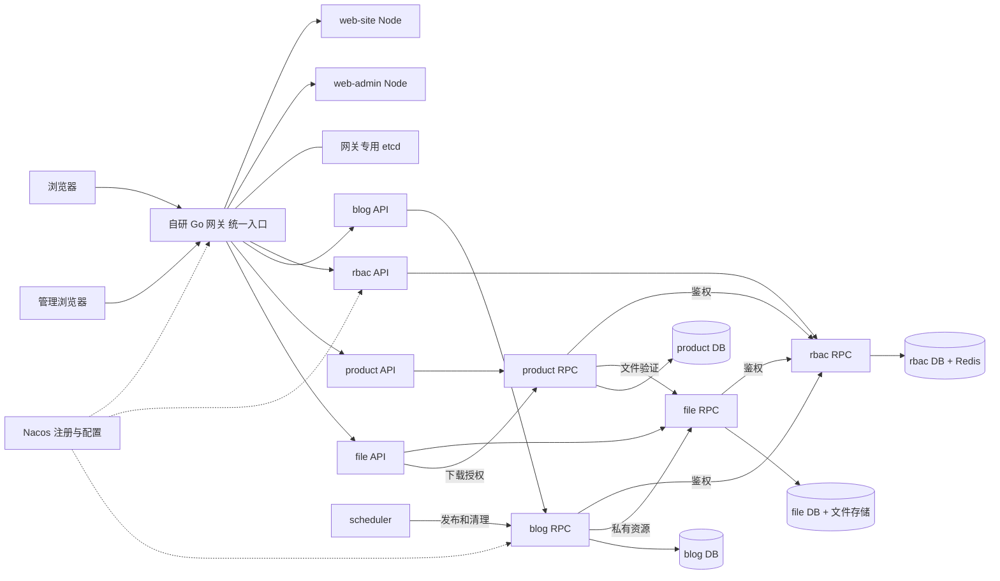

# SiteHub 微服务架构

四个业务域各拥有 API、RPC、数据与业务规则，scheduler 只负责任务触发。九个 Go 进程与两个 Node 前端进程可分别构建和部署。新模块不导入或 replace 原后端，跨域数据访问通过强类型 protobuf 协议完成。

## 数据归属

| 业务域 | 拥有的数据与规则 | 跨域能力 |
| --- | --- | --- |
| rbac | 管理员、角色、菜单、关联、登录日志、会员、验证码、会话、黑名单、邮件配置 | 向其他域提供 Authorize / CheckClient |
| blog | 文章、分类、标签、修订、发布快照、资源元数据及引用、浏览统计 | 通过 file RPC 操作资源；通过 rbac RPC 验证身份 |
| product | 站点内容、下载发布清单、文档模式/版本/分组/正文/修订 | 通过 file RPC 检查文件；通过 rbac RPC 验证会员及管理员 |
| file | 存储配置、物理文件、加密存储快照、本地或对象存储读写 | rbac 鉴权；API 通过 product RPC 取得下载授权 |
| scheduler | 触发计划、超时与停止生命周期；无业务表 | 仅调用 blog 的发布/清理 RPC |

每个 RPC 只连接自己的数据库；数据库名、账号、连接池和超时独立配置。`common/settings` 共享配置存取代码，实际表在各域自己的库中，并限制允许访问的配置键。文章作者使用 ID 与名称快照，不对 rbac 用户表建立数据库关联。

## 分层约束

`api/internal/handler` 处理 HTTP 参数，`api/internal/logic` 调用 RPC 并转换响应；API 不持有数据库连接。`rpc/internal/server` 将生成的方法委托给一个用例对应的 Logic；Logic 进行身份校验、协议转换并调用本域 `business`。`business` 保留可独立测试的领域规则和事务编排，`model` 管理本域实体、仓库与 schema。

ServiceContext 是运行时依赖的构造入口。文件的 multipart、Range/HEAD 和字节流由原生 Handler 与 gRPC stream 实现，不将 HTTP 请求封装成 RPC 隧道。传输接口和数据库实体分离，跨域允许公开 `contract`、RPC `pb/client` 和能力适配器，禁止引用其他域的 `business/model`。

九个服务进程使用 `common/command` 的 Cobra 命令入口，Viper 管理配置文件、环境变量和参数优先级。合并后的配置由 go-zero 解码，以保留 `RestConf` / `RpcServerConf` / `RpcClientConf` 的默认中间件、超时及字段约束。每个进程有独立环境变量前缀；`common/configcenter/nacos` 获取并监听远端配置，`common/runtimeconfig` 只原子更新显式动态字段，静态依赖变更需重启。业务依赖仍由本服务的 ServiceContext 构造。注册发现和退出流程由 `common/governance` 统一接入，RPC 使用 Nacos resolver。

`tests/architecture` 自动检查依赖方向、API 禁止访问持久化层、common 禁止反向导入业务、scheduler 禁止直接访问数据库。实现参考 [go-zero-looklook / zero-admin](docs/architecture-reference.md)，目录保留 `service/<domain>/api|rpc`。

## 身份和错误

API 只接收用户 Bearer/TOTP 凭据，将可信连接 IP 与用户代理作为元数据传递；内部服务密钥由 ServiceContext 配置。RPC 拦截器验证服务身份并执行 IP 策略，用例向 rbac 查询实时身份与权限。管理员与会员使用不同认证域，停用、撤销会话和角色权限变更在请求时校验。

客户端错误映射为 400/401/403/404/409/429，依赖暂不可用或超时为 503/504，未分类异常隐藏内部详情。请求体、RPC 载荷、SQL 绑定参数不写入通用日志。健康检查不要求服务密钥，但不返回业务数据。

## 事务与外部文件

文章正文、发布快照、资源引用、修订和操作幂等记录由 blog 在本地事务中维护。公开列表、搜索和详情只读取发布快照；编辑草稿不会覆盖线上内容。状态转换校验版本，过期写入返回冲突，不能将缺失历史的旧式记录自动补成有效快照。

文章资源的元数据和授权属于 blog，文件实体属于 file。上传先记录持久化 pending 状态，再通过 file RPC 写入，失败保留可恢复记录。清理先在 blog 事务中退休资源，再删除物理文件；失败记录供后续任务重试。外部文件 I/O 不放入数据库事务，避免以跨服务调用延长数据库锁。

product 的文档修订与关联变更在本域事务内完成；下载清单使用快照比较控制并发，新发布或变更的本地文件通过 file RPC 验证。下载请求由 product 检查会员与当前发布状态，file API 再流式读取。本地安装包不提供绕过授权的公开路径。

文件流以有界分块传输并校验声明大小；临时文件在退出时清理。下载使用可重新打开的 RPC 流支持 Range/HEAD，避免将整个安装包载入内存。存储快照依赖稳定的 `STORAGE_SECRET`，更换该密钥需要显式的数据与密钥迁移。

## 调度与数据库生命周期

scheduler 是独立 main，启动后等待退出信号；停止时取消任务上下文并等待退出。默认每分钟发布、每小时清理，单次任务预算两分钟；同一进程避免任务重叠。业务判定和事务均在 blog，scheduler 没有数据库依赖。

当前调度只支持单副本运行，没有跨进程租约。需要调度高可用时再增加选主或任务队列，不能直接增加多个 scheduler 副本并假设全局只执行一次。

`tools/bootstrap` 只初始化显式选择的新服务数据库，并写入归属及版本标记；RPC 启动要求标记匹配。原有数据库升级、旧接口转发、旧 Cookie 适配和单体运行入口均不属于新项目。已有生产数据的转入应作为独立、可审计的离线数据任务设计。

验证范围与未验证环境见 [功能迁移说明](docs/full-migration.md)。

## 前端边界

`web/site`、`web/admin` 独立构建、独立 Node 进程部署，`web/shared` 只共享前端渲染与协议工具。Node 提供静态页面、SPA 路由与健康检查。自研 Go 网关 统一转发 `/v1/<domain>`；rbac API 签发浏览器 Cookie，网关按 Host/身份域转换为 Bearer 并检查 Cookie 写请求的 Origin，身份与权限仍由 rbac 实时判定。

网关保留 Range/HEAD 和流式传输，Node 不参与文件代理。开发 Vite 仅代理统一网关；网关通过 Nacos 发现 API，所有内部 RPC 通过 Nacos 订阅寻址。详见 [治理运行指南](docs/gateway-governance-operations.md) 与 [前端说明](web/README.md)。
