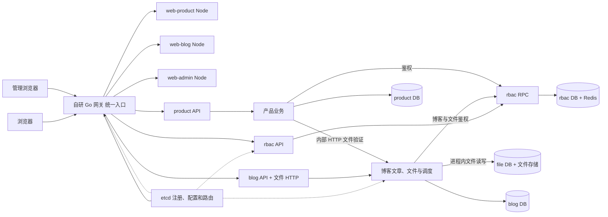

# SiteHub 微服务架构

三个业务域共运行四个 Go 进程：rbac-api、rbac-rpc、blog-api、product-api。博客和产品只监听 HTTP，管理、产品、博客三个前端各自部署。

## 数据归属

| 业务域 | 拥有的数据与规则 | 跨域能力 |
| --- | --- | --- |
| rbac | 管理员、角色、菜单、关联、登录日志、会员、验证码、会话、黑名单、邮件配置 | 向其他域提供 Authorize / CheckClient |
| blog | 文章、分类标签、快照修订、资源引用、统计；文件存储与读写；发布和清理调度 | 文件、调度进程内调用；rbac RPC 鉴权，API 通过 product 内部 HTTP 接口 取得下载授权 |
| product | 站点内容、下载发布清单、文档模式/版本/分组/正文/修订 | 通过 blog 内部 HTTP 接口 检查文件；通过 rbac RPC 验证会员及管理员 |

rbac-rpc 和 product-api 各连接自己的数据库；blog-api 同时连接 blog 和 file 两个逻辑库，分别由 `Database` 与 `FileDatabase` 配置账号、连接池和超时。保留原有 schema 所有权，不在运行时自动合库或迁移数据。`common/settings` 共享配置存取代码，实际表在各域自己的库中，并限制允许访问的配置键。文章作者使用 ID 与名称快照，不对 rbac 用户表建立数据库关联。

## 分层约束

博客和产品在 `api/internal/handler` 解析 HTTP 请求，`api/internal/logic` 调用本域业务。RBAC 继续通过 RPC 执行身份和权限判断。

ServiceContext 管理数据库及出站客户端。博客直接在 HTTP Handler 处理文件流、Range 和 HEAD，跨域使用公开的 contract 与客户端。

博客的业务用例在 `business`，文件库和博客库在同一个 API 进程中装配。`jobs` 直接调用发布和清理能力。

旧部署升级时停止原博客和产品 RPC 容器，并在新 API 配置中保留现有数据库和文件卷。

四个业务进程使用 `common/command` 的 Cobra 命令入口，Viper 管理配置文件、环境变量和参数优先级。合并后的配置由 go-zero 解码，以保留 `RestConf` / `RpcServerConf` / `RpcClientConf` 的默认中间件、超时及字段约束。每个进程有独立环境变量前缀；`common/configcenter` 与 `common/registry` 定义代理接口，`common/controlplane` 统一装配 etcd 适配，获取/监听配置并管理服务租约，`common/runtimeconfig` 只原子更新显式动态字段，静态依赖变更需重启。业务依赖仍由本服务的 ServiceContext 构造。注册发现和退出流程由 `common/governance` 统一接入，RPC 使用 `discovery:///` resolver。

`tests/architecture` 自动检查依赖方向、API 禁止访问持久化层、common 禁止反向导入业务、blog/jobs 只依赖任务能力接口。实现参考 [go-zero-looklook / zero-admin](docs/architecture-reference.md)，目录保留 `service/<domain>/api|rpc`。

## 身份和错误

API 只接收用户 Bearer/TOTP 凭据，将可信连接 IP 与用户代理作为元数据传递；内部服务密钥由 ServiceContext 配置。RPC 拦截器验证服务身份并执行 IP 策略，用例向 rbac 查询实时身份与权限。管理员与会员使用不同认证域，停用、撤销会话和角色权限变更在请求时校验。

客户端错误映射为 400/401/403/404/409/429，依赖暂不可用或超时为 503/504，未分类异常隐藏内部详情。请求体、RPC 载荷、SQL 绑定参数不写入通用日志。健康检查不要求服务密钥，但不返回业务数据。

## 事务与外部文件

文章正文、发布快照、资源引用、修订和操作幂等记录由 blog 在本地事务中维护。公开列表、搜索和详情只读取发布快照；编辑草稿不会覆盖线上内容。状态转换校验版本，过期写入返回冲突，不能将缺失历史的旧式记录自动补成有效快照。

文章资源的元数据和授权属于 blog，文件实体由 blog-api 内嵌的文件模块管理。上传先记录持久化 pending 状态，再通过进程内文件能力写入，失败保留可恢复记录。清理先在 blog 事务中退休资源，再在进程内删除物理文件；失败记录供后续任务重试。外部文件 I/O 不放入数据库事务，避免以跨服务调用延长数据库锁。

product 的文档修订与关联变更在本域事务内完成；下载清单使用快照比较控制并发，新发布或变更的本地文件通过 blog 内部 HTTP 接口 验证。下载请求由 product 检查会员与当前发布状态，blog-api 的文件处理器再流式读取。本地安装包不提供绕过授权的公开路径。

文件流以有界分块传输并校验声明大小；临时文件在退出时清理。下载使用可重新打开的 RPC 流支持 Range/HEAD，避免将整个安装包载入内存。存储快照依赖稳定的 `STORAGE_SECRET`，更换该密钥需要显式的数据与密钥迁移。

## 调度与数据库生命周期

调度内嵌 blog-api，直接调用文章发布和资源清理用例，不再启动独立进程或通过 RPC 回调自身；停止时先取消任务上下文并等待任务退出，再关闭文件和数据库资源。默认每分钟发布、每小时清理，单次任务预算两分钟；同一进程避免任务重叠。业务判定和事务均在 blog，jobs 仅依赖能力接口。

当前调度只支持单副本运行，没有跨进程租约。需要调度高可用时再增加选主或任务队列，额外 blog-api 副本必须关闭 `Scheduler.Enabled`，不能直接让多个副本都触发调度并假设全局只执行一次。

`tools/bootstrap` 只初始化显式选择的新服务数据库，并写入归属及版本标记；RPC 启动要求标记匹配。原有数据库升级、旧接口转发、旧 Cookie 适配和单体运行入口均不属于新项目。已有生产数据的转入应作为独立、可审计的离线数据任务设计。

验证范围与未验证环境见 [功能迁移说明](docs/full-migration.md)。

## 前端边界

`web/product`、`web/blog`、`web/admin` 各自构建和部署，分别维护自己的页面服务与协议工具。Node 提供静态页面、SPA 路由与健康检查。自研 Go 网关 统一转发 `/v1/<domain>`；rbac API 签发浏览器 Cookie，网关按 Host/身份域转换为 Bearer 并检查 Cookie 写请求的 Origin，身份与权限仍由 rbac 实时判定。

网关保留 Range/HEAD 和流式传输，Node 不参与文件代理。开发 Vite 仅代理统一网关；网关与 RPC 通过注册代理订阅 etcd 实例地址，服务记录使用租约续期；配置代理以独立键空间发布和监听业务参数。详见 [etcd 配置指南](deploy/etcd/README.md) 与 [前端说明](web/README.md)。
